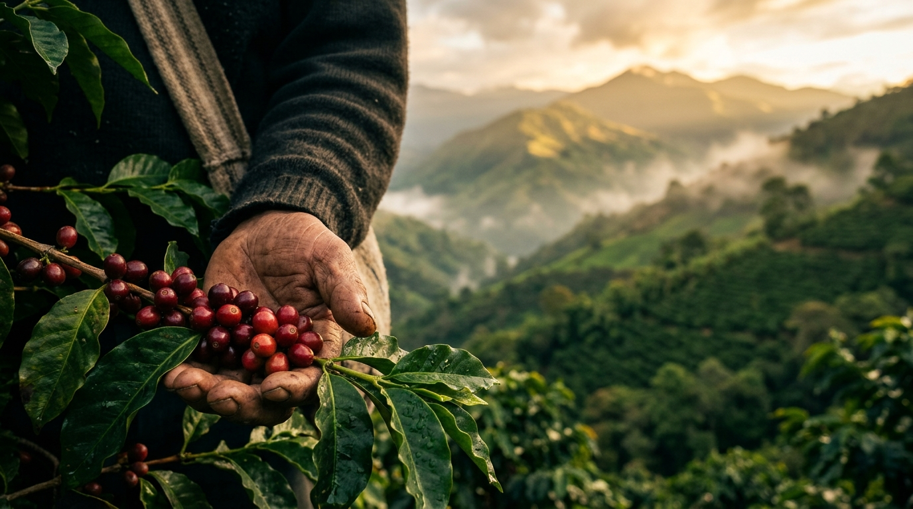
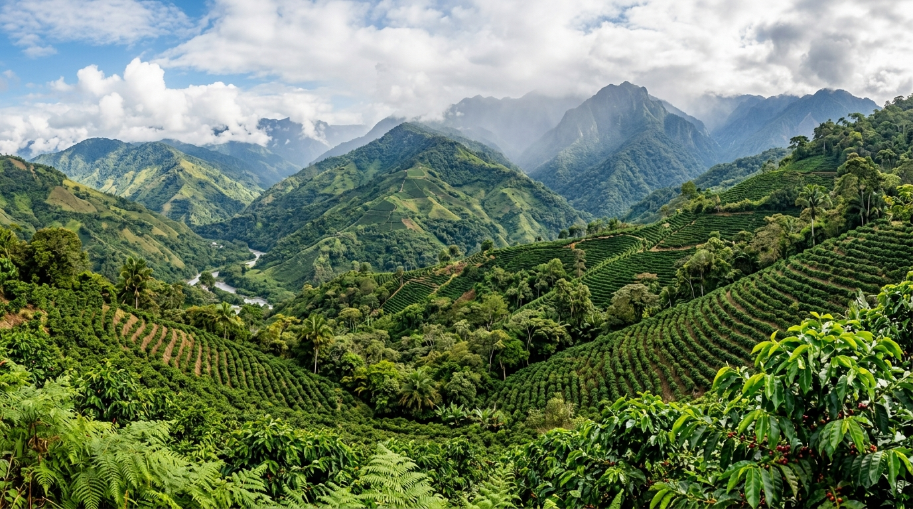
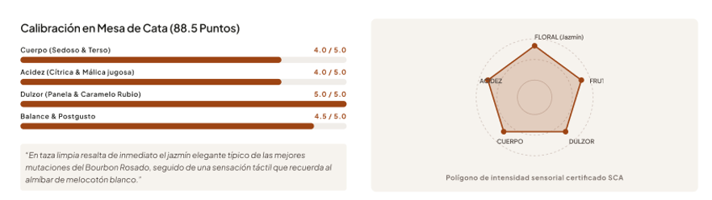
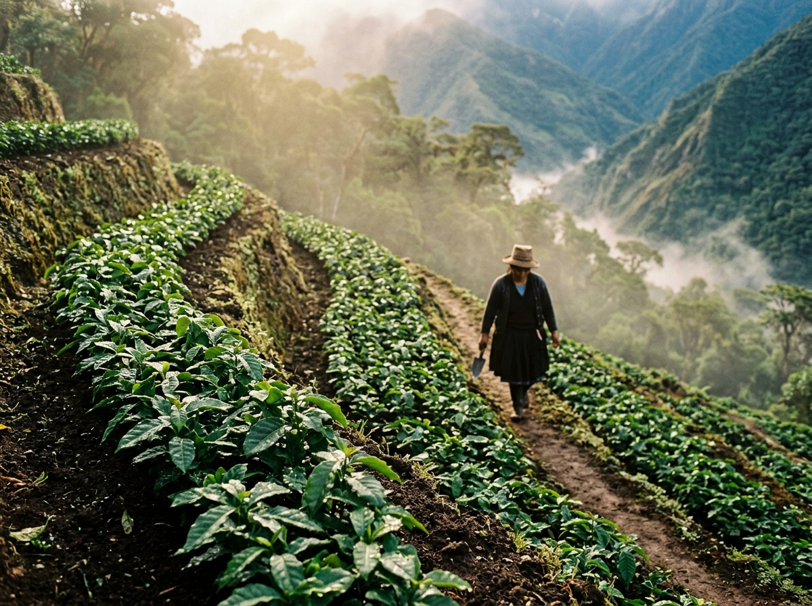
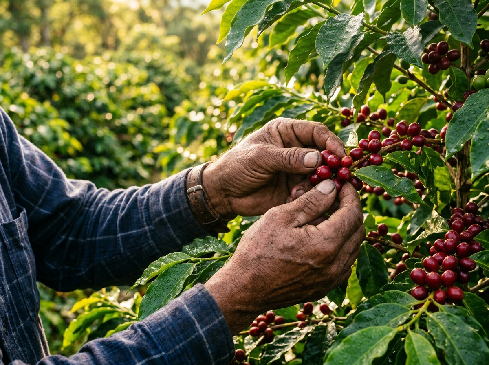
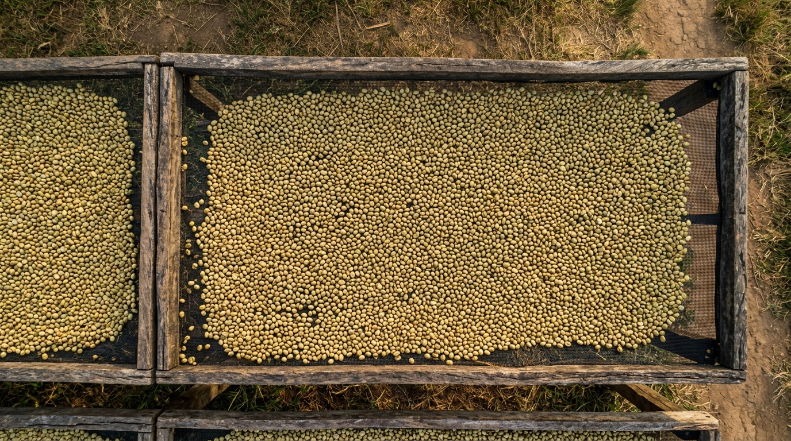
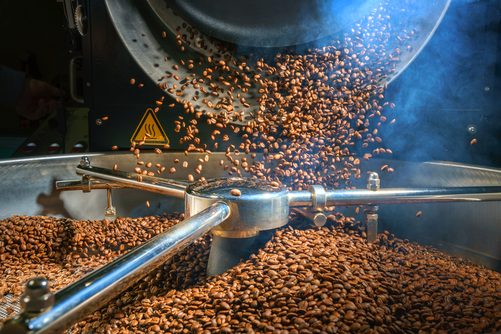
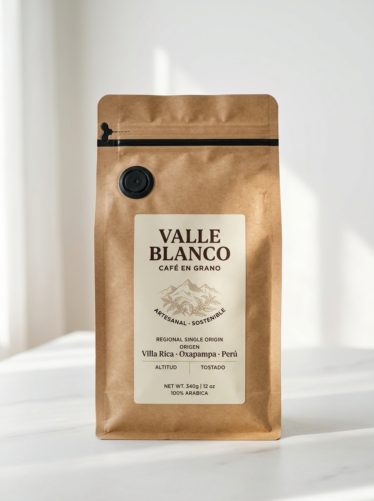
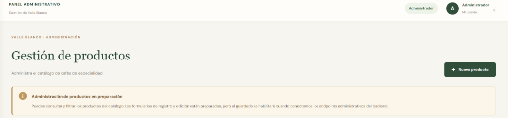

# ☕ E-commerce Café Valle Blanco

<p align="center">
  
</p>

Plataforma de comercio electrónico integral desarrollada para la empresa cafetalera **Valle Blanco**, especializada en la exhibición, comercialización, control logístico y trazabilidad de cafés de especialidad peruanos cultivados bajo sombra en **Villa Rica, provincia de Oxapampa**.

Este proyecto ha sido desarrollado como parte del curso **Herramientas de Desarrollo**.

---

## 📋 Tabla de Contenidos

1. [Arquitectura del Sistema](#-arquitectura-del-sistema)
2. [Tecnologías Utilizadas](#-tecnologías-utilizadas)
3. [Módulos y Funcionalidades](#-módulos-y-funcionalidades)
   * [1. Portal del Cliente (E-commerce)](#1-portal-del-cliente-e-commerce)
   * [2. Ficha Técnica SCA & Polígono Sensorial](#-ficha-técnica-sca--polígono-sensorial)
   * [3. Nuestro Proceso Artesanal (9 Etapas)](#-nuestro-proceso-artesanal-en-9-etapas)
   * [4. Panel Administrativo (`/admin`)](#2-panel-administrativo-general-admin)
   * [5. Panel de Inventario & Almacén (`/inventario`)](#3-panel-de-inventario--almacén-inventario)
4. [Roles y Permisos del Sistema](#-roles-y-permisos-del-sistema)
5. [Requisitos Previos](#-requisitos-previos)
6. [Configuración de la Base de Datos](#-configuración-de-la-base-de-datos)
7. [Instrucciones de Ejecución](#-instrucciones-de-ejecución)
8. [Módulos de la API REST](#-módulos-de-la-api-rest)

---

## 🏛 Arquitectura del Sistema

El proyecto opera bajo un modelo desacoplado con arquitectura de tres capas: **Frontend SPA/SSR + Backend RESTful API + Base de Datos Relacional PostgreSQL**.

```
Ecomerce_CafeValleBlanco/
├── Backend/                              # API RESTful con Spring Boot 4.1.1 & Java 21
│   ├── src/main/java/com/valleblanco/backend/
│   │   ├── config/                       # Seguridad (Spring Security), CORS, JWT, GlobalExceptionHandler y DataInitializer
│   │   ├── controller/                   # Endpoints REST (Auth, Products, Inventario, Pedidos, Usuario, Admin)
│   │   ├── dto/                          # Objetos de Transferencia de Datos (DTOs)
│   │   ├── model/                        # Entidades JPA (Product, Usuario, Role, Pedido, MovimientoStock, etc.)
│   │   ├── repository/                   # Repositorios Spring Data JPA
│   │   └── service/                      # Lógica de negocio, auditoría y generación de PDFs (OpenPDF)
│   ├── src/main/resources/
│   │   ├── db/migration/                 # Scripts de migración versionados con Flyway
│   │   └── application.properties        # Configuración del servidor (puerto 8081, DB, JWT, multipart 10MB)
│   ├── Dockerfile                        # Imagen Docker optimizada para Render (MaxRAMPercentage=75, headless)
│   └── pom.xml                           # Descriptor Maven y dependencias
│
├── Frontend/                             # Aplicación Web con Angular 22.1 & TypeScript
│   ├── src/app/
│   │   ├── core/                         # Guards de rutas, interceptores HTTP, modelos y servicios
│   │   └── modules/
│   │       ├── auth/                     # Inicio de sesión y registro de usuarios
│   │       ├── client/                   # Tienda pública (Home, Catálogo, Detalle, Nuestro Café,
│   │       │                             # Nuestro Proceso, Sobre Nosotros, Carrito, Checkout, Pedidos, Perfil)
│   │       ├── admin/                    # Panel administrativo (Dashboard, Productos, Pedidos, Clientes,
│   │       │                             # Reportes & Gráficos, Inventario solo lectura, Seguridad y Preferencias)
│   │       └── stock/                    # Panel de almacén (Dashboard, Control de Stock, Movimientos)
│   ├── public/assets/images/             # Fotografías, sellos y recursos visuales estáticos
│   └── package.json                      # Dependencias y scripts de Angular / Node.js
└── README.md
```

---

## 🛠 Tecnologías Utilizadas

### **Backend**
* **Lenguaje:** Java 21 (LTS).
* **Framework:** Spring Boot 4.1.1 (`spring-boot-starter-webmvc`, `spring-boot-starter-data-jpa`, `spring-boot-starter-security`).
* **Migraciones de BD:** Flyway Database Migrations con soporte para PostgreSQL.
* **Seguridad y Cifrado:** Spring Security + JWT (jjwt 0.12.6) + BCrypt Password Encoder.
* **Generación de PDF:** OpenPDF (`com.github.librepdf:openpdf`) para reportes ejecutivos, reportes individuales y comprobantes por pedido.
* **Base de Datos:** PostgreSQL 14+ (compatible con Neon).
* **Herramientas de Soporte:** Project Lombok, Spring Boot DevTools, Maven Wrapper (`mvnw`), Docker.

### **Frontend**
* **Framework:** Angular 22.1 (Standalone Components + Signals + Router Guards + SSR con Express 5).
* **Lenguaje:** TypeScript ~6.0 / HTML5 / SCSS.
* **Estilos y Diseño:** SCSS modular con paleta artesanal inspirada en la finca cafetalera (`#304E3A`, `#8A674E`, `#F3EEE4`).
* **Gráficos & Visualizaciones:**
  * `Chart.js` 4.6 + `ng2-charts` 11.0 (protegidos con `isPlatformBrowser` para SSR) en el módulo de Reportes y Métricas.
  * Polígono de Intensidad Sensorial interactivo en SVG nativo (Radar Chart SCA) en la ficha de producto.
* **Cliente HTTP:** Angular `HttpClient` reactivo con RxJS.

---

## 📦 Módulos y Funcionalidades

### 1. Portal del Cliente (E-commerce)

<p align="center">
  
</p>

* **Home:** Hero editorial, manifiesto rústico de finca, guía interactiva del barista con calibración de métodos de extracción (V60, Prensa Francesa, Espresso, Chemex, Aeropress, Moka) y destacados de cosecha.
* **Catálogo & Filtros:** Búsqueda rápida y filtrado por molienda, variedades y tipo de café.
* **Nuestro Café:** Vista territorial de Villa Rica, microclima de bosque de niebla (12°C–18°C), suelos volcánicos y fichas de variedades emblemáticas (*Caturra*, *Typica* y *Bourbon Rosado*).
* **Sobre Nosotros:** Historia familiar, significado del nombre Valle Blanco, localización en la **Reserva de Biósfera Oxapampa-Asháninka-Yánesha (UNESCO)**, Misión, Visión, Valores y diferenciales.
* **Carrito y Checkout:** Gestión de cantidades, validación de stock disponible, resumen de compra y confirmación de pedidos (habilitado exclusivamente para clientes).
* **Mis Pedidos & Comprobantes:** Historial de compras con fotografías de los productos adquiridos, detalle de entrega y **descarga de comprobante PDF** por cada pedido.
* **Perfil de Usuario:**
  * Visualización y edición de datos personales (`nombres`, `apellidos`, `teléfono`) con sincronización inmediata en sesión.
  * **Foto de perfil:** Carga de imagen (hasta 10 MB) con compresión automática en navegador, disponible al activar el modo de edición.
  * **Cambio de contraseña:** Formulario dedicado con verificación de contraseña actual, validación cruzada de coincidencia e indicador visual de fortaleza.

---

### 🔬 Ficha Técnica SCA & Polígono Sensorial

En la vista de detalle de producto se incluye la calibración sensorial de mesa de cata certificada y el polígono interactivo de intensidad en SVG:

<p align="center">
  
</p>

* **Puntuación SCA:** Indicador de calidad (+86 Puntos) y notas de cata oficiales.
* **Barras de Atributos:** Cuerpo sedoso, acidez cítrica, dulzor a caramelo/panela y balance.
* **Polígono de Radar SVG:** Gráfico vectorial de 5 vértices que modela el perfil de taza del café seleccionado.

---

### 🌱 Nuestro Proceso Artesanal en 9 Etapas

Recorrido visual secuencial desde el cultivo en laderas andino-amazónicas hasta el empaque final:

| 01. Cultivo | 02. Cosecha Selectiva | 05. Secado en Camas |
|:---:|:---:|:---:|
| <br>**1,200–1,800 msnm** | <br>**Recolección manual 100%** | <br>**Lento al sol (11% humedad)** |
| **07. Tostado en Tambor** | **08. Molienda Calibrada** | **09. Empaque Hermético** |
| <br>**Micro-lotes (180–220 °C)** | <br>**Muelas cónicas de precisión** | <br>**Válvula desgasificadora** |

---

### 2. Panel Administrativo General (`/admin`)

<p align="center">
  
</p>

* **Dashboard Gerencial:** Métricas de ventas, órdenes recientes, productos más vendidos y resumen financiero.
* **Reportes y Métricas (`/admin/reportes`):**
  * **Gráficos interactivos (`Chart.js`):** Evolución de ventas, distribución de métodos de pago, productos más vendidos, estados de pedidos y **ventas por departamento del Perú** (gráfico horizontal + ranking).
  * **Reportes independientes:** Vistas y descargas en PDF individuales por módulo (Ventas, Productos, Pedidos, Clientes y Ventas por Departamento) y reporte general consolidado.
* **Gestión de Productos:**
  * Alta, edición y baja de productos con validaciones completas.
  * **Subida física de fotografías (hasta 10 MB):** Carga multipart que almacena el archivo en el servidor y asigna la URL relativa.
  * **Eliminación en cascada:** Al borrar un producto se elimina su registro en BD y su archivo de imagen asociado en disco (respetando imágenes maestras del sistema).
  * Menús desplegables controlados para *Tipo de café*, *Molienda*, *Tueste* y *Variedad*.
* **Gestión de Pedidos:** Actualización de estados (`PENDIENTE`, `PAGADO`, `ENVIADO`, `ENTREGADO`, `CANCELADO`), visualización de fotografías de los cafés del pedido y descarga de comprobante PDF por pedido.
* **Directorio de Clientes:** Consulta de usuarios registrados, métricas de compra y detalle de actividad.
* **Inventario Solo Lectura (`/admin/inventario`):** Consulta de existencias ordenadas por ID creciente, sin acceso a registrar entradas o salidas directas.
* **Seguridad y Auditoría (`/admin/seguridad`):** Sección dedicada al registro de auditoría de actividad del sistema.

---

### 3. Panel de Inventario & Almacén (`/inventario`)
* **KPIs de Almacén:** Existencias físicas totales ordenadas por ID creciente, alertas de stock bajo y productos agotados (0 unidades).
* **Registro de Movimientos:** Entradas por lote tostado, salidas por mermas/degustación y ajustes de conteo físico en estantería.
* **Trazabilidad y Auditoría:** Cada movimiento queda registrado con usuario responsable, fecha/hora, motivo y variación de stock.
* **Gestión de Alertas:** Configuración de umbral de stock mínimo por producto.

---

## 🔐 Roles y Permisos del Sistema

El sistema implementa el **Principio de Mínimo Privilegio (PoLP)**:

| Rol | Alcance y Responsabilidades | Acceso a Rutas |
|---|---|---|
| **`ROLE_CLIENTE`** | Exploración del catálogo, compra en línea, gestión de carrito, descarga de comprobantes y consulta de sus pedidos propios. | `/client/**`, `/auth/**` |
| **`ROLE_ENCARGADO_STOCK`** | Operaciones exclusivas de almacén: entradas de lote, salidas por merma, ajustes físicos y alertas de stock. Sin capacidad de compra ni acceso a ventas globales. | `/inventario/**`, `/client/perfil` |
| **`ROLE_ADMIN`** | Control total gerencial: ventas, catálogo, precios, clientes, pedidos, reportes PDF/gráficos, inventario de solo lectura y auditoría de seguridad. Sin capacidad de compra en tienda. | `/admin/**`, `/client/perfil` |

---

## ⚙️ Requisitos Previos

* **Java JDK:** Versión 21 o superior (`java -version`).
* **Node.js:** Versión 20 o superior (`node -v`).
* **Gestor de paquetes:** npm o pnpm (`npm -v` o `pnpm -v`).
* **PostgreSQL:** Versión 14 o superior en ejecución en el puerto `5432`.

---

## 🗄️ Configuración de la Base de Datos

1. Abre tu cliente PostgreSQL (`psql`, pgAdmin o DBeaver).
2. Crea la base de datos del proyecto:
   ```sql
   CREATE DATABASE "ValleBlanco";
   ```
3. Verifica la configuración de conexión en [`Backend/src/main/resources/application.properties`](file:///Backend/src/main/resources/application.properties):
   ```properties
   server.port=8081
   spring.datasource.url=jdbc:postgresql://localhost:5432/ValleBlanco
   spring.datasource.username=postgres
   spring.datasource.password=TU_CONTRASEÑA
   ```
   > *Nota: Flyway creará automáticamente las tablas al iniciar el servidor en entorno de desarrollo. Configura las credenciales sensibles mediante variables de entorno.*

---

## 🚀 Instrucciones de Ejecución

### 1. Iniciar el Backend (Spring Boot)

En una terminal ubicada en la carpeta `Backend`:

```bash
cd Backend
./mvnw spring-boot:run
```

*(En Windows PowerShell o CMD usa `mvnw.cmd spring-boot:run`)*

El backend se levantará en: **`http://localhost:8081`**

### 2. Iniciar el Frontend (Angular)

En una segunda terminal ubicada en la carpeta `Frontend`:

```bash
cd Frontend
npm install
npm start
```

La aplicación web estará disponible en: **`http://localhost:4200`**

---

## 📡 Módulos de la API REST

La API sigue el estándar REST con autenticación stateless mediante **JWT** y control de acceso basado en roles (`@PreAuthorize` / `SecurityFilterChain`):

* **`/api/auth`** — Inicio de sesión y registro de clientes.
* **`/api/products`** — Consulta pública del catálogo y gestión administrativa de productos.
* **`/api/usuario`** — Gestión de perfil y actualización segura de contraseña del usuario autenticado.
* **`/api/carrito` y `/api/pedidos`** — Flujo de compras, historial de pedidos y generación de comprobantes PDF (exclusivo para clientes).
* **`/api/inventario`** — Consulta de existencias, alertas de stock mínimo y trazabilidad de movimientos de almacén.
* **`/api/admin`** — Gestión de órdenes, clientes, auditoría y exportación de reportes y métricas en PDF.

---

<p align="center">
  
</p>

<p align="center">
  <strong>Valle Blanco — Café de Especialidad</strong><br>
  <em>Cultivado bajo sombra a más de 1,600 msnm en Villa Rica, provincia de Oxapampa, Perú.</em>
</p>
